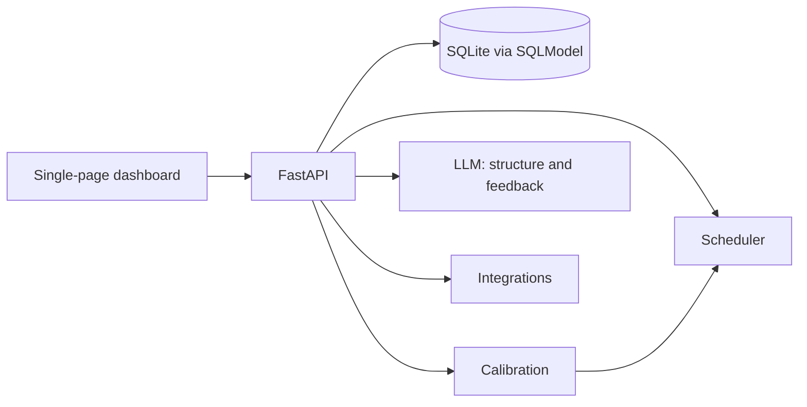
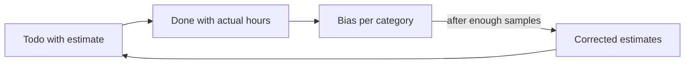

# dashME: Architecture

## System overview

One process, one database file. There is no container setup and no separate database server, on purpose: it is a personal tool.

## Data model

Todos, ideas, captured notes, fixed blocks (recurring commitments), free slots (a weekly template), and small configuration records. Schema changes are additive only.

## Calibration loop

- The factor is the ratio of actual to estimated hours per category.
- It is only trusted after a minimum number of samples and is clamped to a sane range.
- Until then the factor is neutral, so a few unlucky tasks cannot distort the plan.

## Scheduler

1. Anchor the weekly slot template onto the next seven real dates.
2. Remove fixed blocks.
3. Place todos into slots that match the needed energy level, using the calibrated hours.
4. Small tasks are placed whole. Large ones are spread across days, with a daily cap.
5. Report what did not fit: hours short and unplaced tasks.

## Integrations

Each integration has a real interface. Some are still stubs with seed data, marked as such: wearable recovery data (OAuth), job listings, and a meal rotation. Personal data stays in the local database.

## Design decisions

- **Honest planning.** The scheduler reports shortfall instead of hiding it.
- **Learn from outcomes.** The only input to the correction is real completed work.
- **Local first.** Personal data never leaves the machine except for the LLM calls the user triggers.
